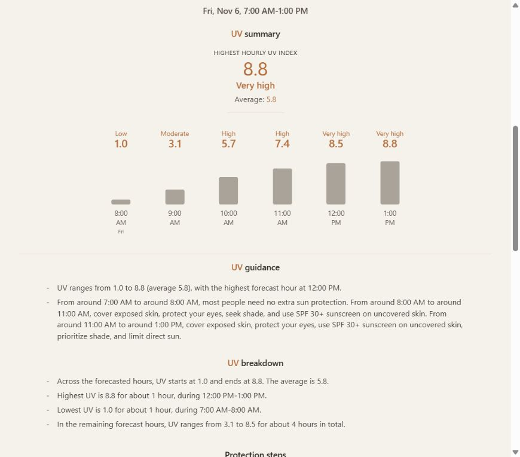
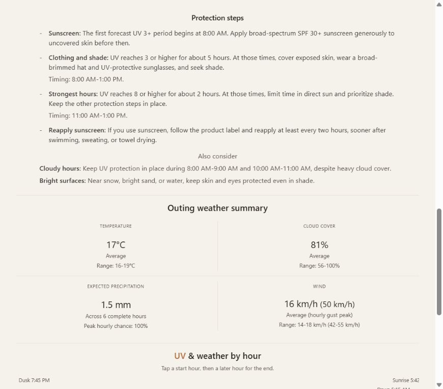

:::{=html}
<link rel="stylesheet" href="https://cdnjs.cloudflare.com/ajax/libs/font-awesome/6.5.1/css/all.min.css" crossorigin="anonymous" referrerpolicy="no-referrer" />
:::

  <a href="../a_bit_of_everything.qmd">A Bit of Everything</a>

 

#### An outing in Cape Town

For a real example, we can choose Cape Town and plan six hours outside on November 6, 2026, from 7:00 AM to 1:00 PM. All times are local to Cape Town. These screenshots were captured from the live app on November 5, 2026, so the values describe the forecast available then.

{class="click-zoom" fig-align="center" width="760"}

The outing starts with a forecast UV Index of 1.0 and reaches 8.8, with an average of 5.8 across the six hours. The guidance separates this into three periods: below 3 from 7:00 AM to 8:00 AM, between 3 and below 8 from 8:00 AM to 11:00 AM, and 8 or higher from 11:00 AM to 1:00 PM. The chart labels mark the end of each forecast hour, so the value of 8.8 at 1:00 PM represents the period from noon to 1:00 PM.

Those periods give the protection steps their timing. In this example, the app recommends applying sunscreen to uncovered skin before the first UV 3+ period at 8:00 AM, keeping protection in place through 1:00 PM, and taking extra care during the strongest hours from 11:00 AM onward. It also highlights cloudy periods when the forecast UV remains elevated.

{class="click-zoom" fig-align="center" width="760"}

The supporting weather summary puts the outing in context: an average temperature of 17 degrees Celsius, average cloud cover of 81%, expected precipitation of 1.5 mm, and average wind of 16 km/h. Together, the UV timeline, protection steps, and weather context show what the selected forecast means for those six hours outside.

### Limitations

UV Scout currently ties an outing to one selected location. That gives us a forecast for a specific point, while many outdoor activities—whether we walk, run, hike, ride, or do something else—take us through multiple places. UV and weather conditions may vary along the way, but the outing summary continues to use the location we selected. It cannot show how conditions change as our position changes or describe the forecast for each part of a route.

This matters most when an outing covers a longer distance or moves through areas with different terrain or elevation. In those cases, the conditions at the selected location may not represent what we encounter throughout the route.

UV exposure can also vary with the landscape along an outing. A route may pass through forest, cross open terrain, or move in and out of shade from buildings and surrounding terrain. UV Scout does not currently account for these changes. If the app included a route, we might be able to use the map to estimate which sections are shaded or exposed, though that estimate would still be approximate.

Finally, UV Scout does not tailor its guidance to the type of activity. A run may involve a cap and lightweight covering clothing, while a bike ride or swim brings different clothing and equipment choices. Sunscreen may also need reapplying after swimming or heavy sweating, as [WHO recommends](https://www.who.int/news-room/questions-and-answers/item/radiation-protecting-against-skin-cancer). The app does not ask what activity we plan to do, so its guidance cannot reflect these practical differences.

These limitations reflect the current version of UV Scout. As we add features and use the app in more kinds of outings, new assumptions or constraints may emerge that we will need to reconsider.

### What I learned

<!-- We will add the project reflection here. -->

### Conclusion

<!-- We will write the takeaway and next steps here. -->

::: {.post-nav}
[Back to A Bit of Everything](../a_bit_of_everything.qmd){.post-nav-back}
:::
